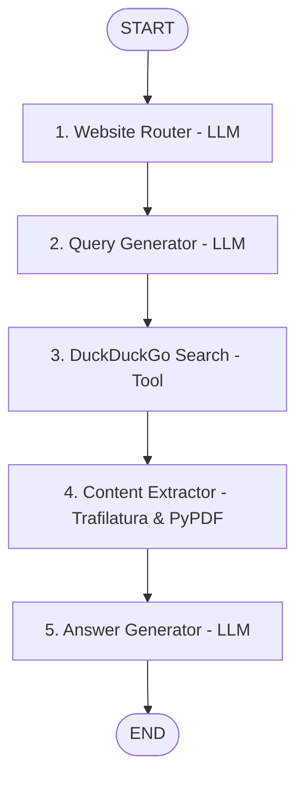

<<<<<<< HEAD
# 🏛️ Financial Policy Research Agent (LangGraph)

An agentic, multi-node **Financial Policy Research Agent** built using **LangGraph**, **DuckDuckGo**, **Trafilatura**, and **Ollama (`qwen2.5:7b`)** / **Google Gemini** / **Groq** / **OpenAI**.

The agent is designed to provide factually verified, hallucination-free answers to regulatory and financial policy questions by searching **exclusively within user-provided trusted financial websites** (e.g., IRDAI, PFRDA).

---

## 🌟 Key Features

- **Strict Domain Constrained Search**: Searches are strictly executed with `site:<trusted-domain>` operators in DuckDuckGo. No unrestricted internet searching is permitted.
- **Accurate Web Extraction with Trafilatura & PyPDF**: Strips navigation bars, boilerplate, cookie popups, and scripts, extracting clean regulatory text and document metadata (dates, titles) from both web pages and PDF circulars.
- **Strict Source Citations & Grounding**: Final responses are strictly grounded in retrieved official documents with clear citations.
- **Multi-LLM Support**: Works out-of-the-box locally with **Ollama (`qwen2.5:7b`)**, or in the cloud with **Google Gemini (`gemini-1.5-flash`)**, **Groq (`llama-3.3-70b`)**, and **OpenAI (`gpt-4o-mini`)**.
- **Interactive Terminal UI**: Clean command-line interface with official source verification and LangSmith tracing support.

---

## 📐 5-Node LangGraph Architecture



### Detailed Breakdown of the 5 Nodes

| # | Node Name | Type | Description |
|---|---|---|---|
| **1** | **Website Router** | LLM | Evaluates the query against trusted websites (`irdai.gov.in`, `pfrda.org.in`) and picks the single most relevant official domain, or flags out-of-scope queries. |
| **2** | **Query Generator** | LLM | Formulates an effective DuckDuckGo query strictly prepended with `site:<selected_domain>` and targeted keywords. |
| **3** | **DuckDuckGo Search** | Tool | Executes the domain-restricted search via DuckDuckGo and validates active HTTP status for returned URLs. |
| **4** | **Content Extractor** | Python | Downloads target webpages/PDFs and uses **Trafilatura** and **pypdf** to extract clean body text and metadata. |
| **5** | **Answer Generator** | LLM | Synthesizes the final policy answer using *only* facts retrieved from the official sources, outputting clear explanations and cited links. |

---

## 📂 Project Directory Structure

```
Langgraph_Project/
├── config.py                 # Configuration, LLM factory & domain helpers
├── state.py                  # AgentState TypedDict schema
├── graph.py                  # LangGraph StateGraph pipeline & compilation
├── main.py                   # Terminal CLI entry point
├── requirements.txt          # Dependencies list
├── .env.example              # Sample environment configuration
├── .env                      # Active environment settings
├── tools/
│   ├── __init__.py
│   ├── search_tool.py        # DuckDuckGo search restricted to site:<domain>
│   └── extractor_tool.py     # Trafilatura & PyPDF scraper and text cleaner
└── nodes/
    ├── __init__.py
    ├── website_router.py     # Node 1: Website Router LLM
    ├── query_generator.py    # Node 2: Query Generator LLM
    ├── duckduckgo_search.py  # Node 3: DuckDuckGo Search Tool
    ├── content_extractor.py  # Node 4: Content Extractor Tool
    └── answer_generator.py   # Node 5: Answer Generator LLM
```

---

## 🚀 Getting Started

### 1. Prerequisites & Installation

Ensure you have **Python 3.10+** installed.

```bash
# Clone or navigate to the repository
cd Langgraph_Project

# Install required dependencies
pip install -r requirements.txt
```

### 2. Configure LLM Provider

The agent supports multiple LLM backends via `.env`:

#### Option A: Local Ollama (Default - 100% Free & Offline Inference)
Make sure Ollama is running with `qwen2.5:7b`:
```bash
ollama run qwen2.5:7b
```
Configure `.env`:
```ini
LLM_PROVIDER=ollama
OLLAMA_MODEL=qwen2.5:7b
OLLAMA_BASE_URL=http://localhost:11434
```

#### Option B: Google Gemini (Free Tier Cloud API)
```ini
LLM_PROVIDER=gemini
GEMINI_API_KEY=your_google_ai_studio_api_key
GEMINI_MODEL=gemini-1.5-flash
```

#### Option C: Groq (Ultra-Fast Cloud API)
```ini
LLM_PROVIDER=groq
GROQ_API_KEY=your_groq_api_key
GROQ_MODEL=llama-3.3-70b-versatile
```

#### Option D: OpenAI
```ini
LLM_PROVIDER=openai
OPENAI_API_KEY=your_openai_api_key
OPENAI_MODEL=gpt-4o-mini
```

---

## 💻 Running the Application

Launch the terminal interface:

```bash
python main.py
```

### Example Queries:
- *"What are the IRDAI regulations regarding health insurance claim settlement turnaround time?"*
- *"What are the PFRDA guidelines on National Pension System (NPS) partial withdrawal rules?"*
- *"What is the minimum entry age and maximum age for NPS under PFRDA?"*
=======
# -Financial-Policy-Research-Agent
>>>>>>> b86e1713336efbae7da4859306fe3ddbd1b638a3
